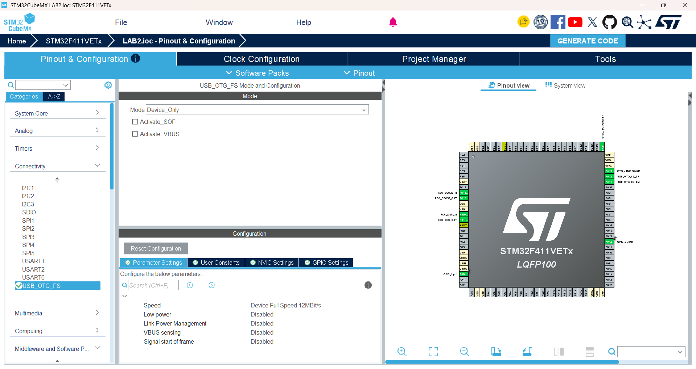
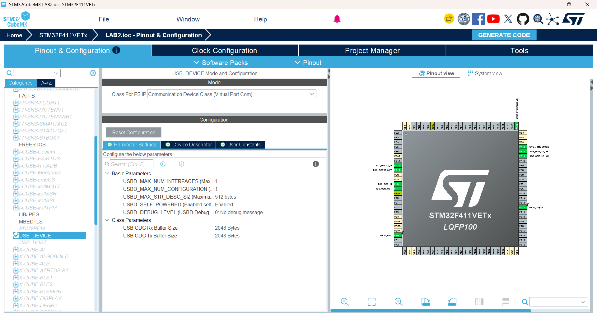
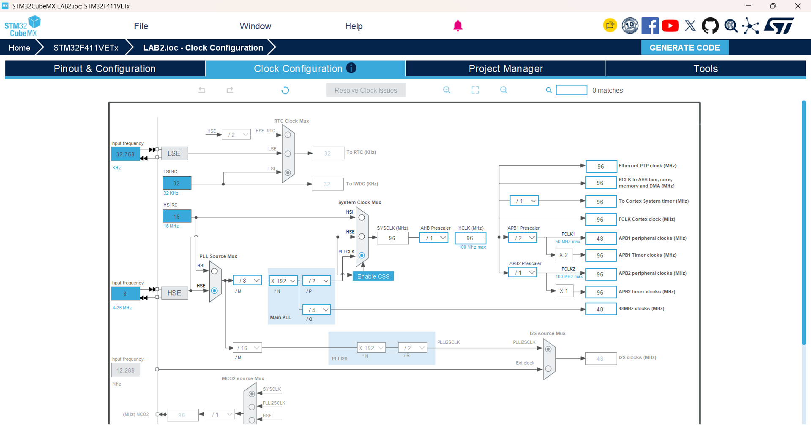
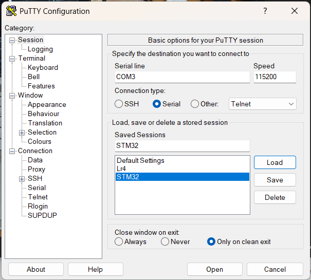
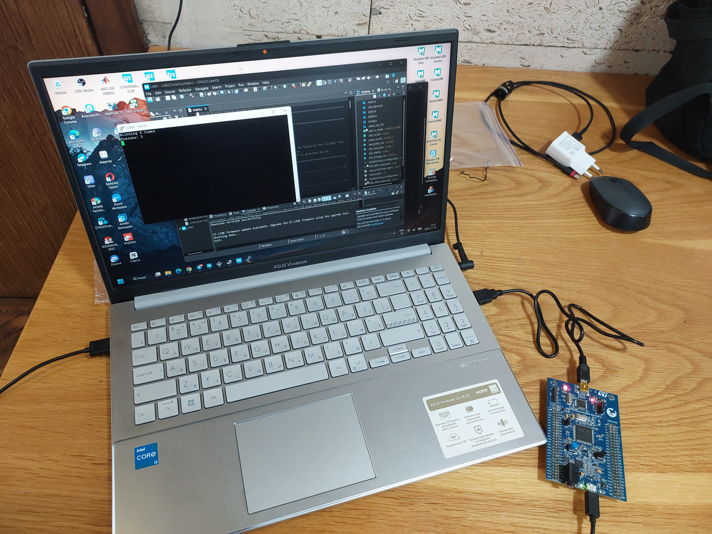
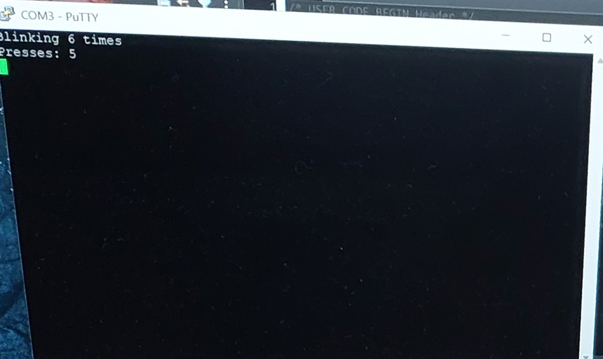

# LAB3
# ЛР 3. Зв'язок ПК та МК

## Мета
Реалізувати двосторонній обмін даними між персональним комп'ютером і мікроконтролером STM32F411VET6 через USB (віртуальний COM-порт, USB CDC) і перевірити його в терміналі PuTTY.

## Обладнання та ПЗ
- Плата STM32F411E-DISCO
- Два кабелі micro-USB: **ST-LINK** (прошивка, живлення) і **USB USER** (зв'язок із ПК)
- STM32CubeMX, STM32CubeIDE, PuTTY

## Теоретичні відомості
**USB CDC (Communication Device Class)** це клас USB-пристроїв, який емулює послідовний порт. На ПК плата визначається як звичайний COM-порт, з яким працюють термінальні програми.

ST-LINK на платі STM32F411E-DISCO не з'єднаний з UART мікроконтролера, тому для зв'язку використано USB-роз'єм **USB USER** (піни PA11 і PA12). USB Full Speed вимагає тактової частоти **48 МГц**, яку забезпечує PLL.

## Параметри
| Параметр | Значення |
|----------|----------|
| Тактування | HSE 8 МГц → PLL (M=8, N=192, P=2, Q=4) |
| SYSCLK / HCLK | 96 МГц |
| Частота USB | 48 МГц |
| APB1 / APB2 | 48 МГц / 96 МГц |
| USB | USB_OTG_FS, Device_Only, клас CDC |
| Кнопка | B1 (PA0) |
| Світлодіод | LD4 (PD12) |
| PuTTY | Serial, 115200, Flow control: None |

## Налаштування в CubeMX




## Алгоритм роботи
**Плата → ПК.** Програма рахує натискання кнопки B1 (з програмним антидребезгом 30 мс). Якщо 1,5 с кнопку не натискали, серію вважаємо завершеною, і на ПК надсилається `Presses: N`.

**ПК → плата.** Число, введене в PuTTY, приймається в перериванні USB (функція `CDC_Receive_FS`), яке збирає рядок до Enter і ставить прапорець. Основний цикл перетворює рядок у число N (допустимо 1..50) і блимає світлодіодом LD4 N разів, надсилаючи на ПК відповідь `Blinking N times`.

```c
// усередині CDC_Receive_FS (usbd_cdc_if.c): збір рядка до Enter
if (c == '\r' || c == '\n') { usb_rx_buf[idx] = 0; idx = 0; usb_rx_ready = 1; }
else usb_rx_buf[idx++] = c;
```

## Порядок перевірки
1. Підключити обидва кабелі, прошити плату, натиснути RESET.
2. У Диспетчері пристроїв знайти новий COM-порт.
3. У PuTTY: Serial, відповідний COM, 115200, Flow control None, Local echo: Force on.
4. Натиснути кнопку B1 кілька разів і перевірити вивід `Presses: N`.
5. Ввести число і Enter, перевірити миготіння LD4 та відповідь плати.

## Результат




## Висновки
Реалізовано двосторонній зв'язок ПК і МК через віртуальний COM-порт (USB CDC): кількість натискань кнопки передається на ПК, а введене на ПК число визначає кількість миготінь світлодіода.

## Файли
- `Core/Src/main.c`, `USB_DEVICE/App/usbd_cdc_if.c`: програма і обробка USB CDC
- `*.ioc`: файл проєкту CubeMX
